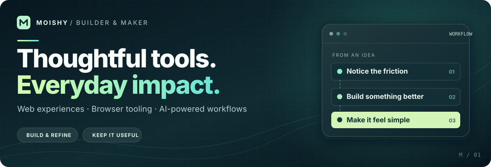
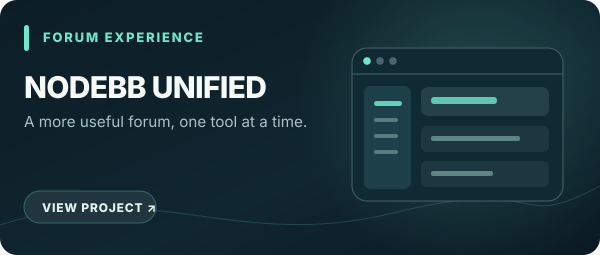
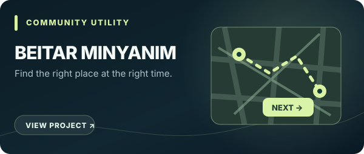
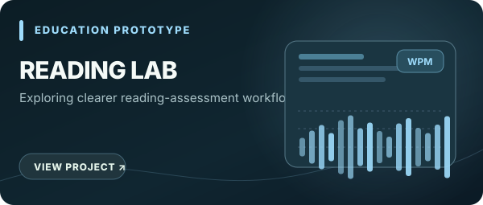
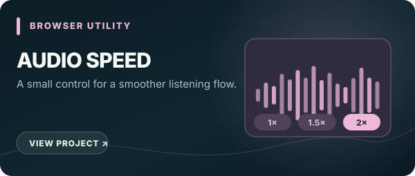

  

  <a href="#selected-work">Selected work</a> &nbsp;·&nbsp;
  <a href="#toolbox">Toolbox</a> &nbsp;·&nbsp;
  <a href="https://github.com/moishyf?tab=repositories&type=public">All public repositories</a>

## Hi, I'm Moishy. 👋

I turn everyday friction into useful software. My work lives at the intersection of **practical web experiences, browser enhancements, and AI-assisted workflows** — with an emphasis on thoughtful interfaces, reliable behavior, and small details that make a big difference.

I enjoy going from *“there should be an easier way”* to a working tool, then refining it until it feels natural to use.

### What I like building

**Browser tools** that improve existing products &nbsp; · &nbsp; **AI-assisted utilities** that reduce repetitive work &nbsp; · &nbsp; **Community-focused web apps** that solve real needs

---

## Selected work

A curated selection of **public projects with source code you can explore**.

<table>
  <tr>
    <td width="50%" valign="top">
       
      <strong><a href="https://github.com/moishyf/NodeBB-Unified">NodeBB Unified</a></strong> 
      A modular collection of browser enhancements for NodeBB forums, including usability and productivity features. 
      JavaScript · Tampermonkey · UI enhancements
    </td>
    <td width="50%" valign="top">
       
      <strong><a href="https://github.com/moishyf/chat-ai-enhancer">Chat AI Enhancer</a></strong> 
      Gemini-powered reply suggestions, rewriting and proofreading for Google Chat and Gmail Chat. 
      JavaScript · Gemini API · Browser userscript
    </td>
  </tr>
  <tr>
    <td width="50%" valign="top">
       
      <strong><a href="https://github.com/moishyf/chat-studio-prozi-userscript">Chat Studio · Prozi</a></strong> (beta) 
      A Tampermonkey adaptation and extension of a community-made conversation styling project, with attribution to its original creator. 
      JavaScript · UX customization · Testing
    </td>
    <td width="50%" valign="top">
       
      <strong><a href="https://github.com/moishyf/betar-minyanim">Beitar Minyanim</a></strong> 
      A community web utility for finding prayer times and locations with search, filters and a map interface. 
      JavaScript · HTML/CSS · Leaflet
    </td>
  </tr>
  <tr>
    <td width="50%" valign="top">
       
      <strong><a href="https://github.com/moishyf/my-new-site">Reading Assessment Prototype</a></strong> 
      An early, public-facing experiment in organizing reading samples, recordings and assessment workflows. <em>Prototype, not a finished product.</em> 
      JavaScript · Education technology · Web UI
    </td>
    <td width="50%" valign="top">
       
      <strong><a href="https://github.com/moishyf/Google-Chat-Audio-Speed-Controller">Google Chat Audio Speed Controller</a></strong> 
      A Tampermonkey port that adds convenient playback-speed controls to voice messages in Google Chat. 
      JavaScript · Browser audio · Userscript port
    </td>
  </tr>
</table>

Also in the workshop: <a href="https://github.com/moishyf/random-auto-reply-userscript">Random Auto Reply</a> — a tiny, playful Google Chat userscript. Explore <a href="https://github.com/moishyf?tab=repositories&type=public">all public repositories</a> for the rest.

---

## Private work · Public overview

Not everything I build is open source. Some projects are developed privately, while their purpose and design thinking can still be shared. **The source code, documentation, and internal data for these projects are not public.**

<table>
  <tr>
    <td width="50%" valign="top">
       
      <strong>Ledaber Kria · Reading Assessment</strong> (in development) 
      A private platform for structured reading assessments, learning support, and personalized practice workflows. 
      Education technology · Product design · Workflow systems 
      🔒 Private repository — overview only
    </td>
    <td width="50%" valign="top">
       
      <strong>Finance Workspace</strong> (in development) 
      A Hebrew-first financial web application exploring clearer records, organized insights, and practical everyday finance workflows. 
      Web application · Data organization · Financial UX 
      🔒 Private repository — overview only
    </td>
  </tr>
</table>

---

## Toolbox

**Languages &amp; web** &nbsp; `JavaScript` `HTML` `CSS`  
**Building &amp; automation** &nbsp; `Userscripts` `Tampermonkey` `Node.js` `GitHub Actions`  
**Exploring** &nbsp; `AI integrations` `Web UX` `Practical automation` `Community tools`

## How I build

> **Notice a problem → Build a focused solution → Test it → Refine the details.**

I'm interested in software that is **clear, useful, and enjoyable to use** — not complexity for its own sake.

  <a href="https://github.com/moishyf?tab=repositories&type=public"><strong>Explore the public code →</strong></a>

Some projects are intentionally kept private. Only explicitly public work is featured here.
